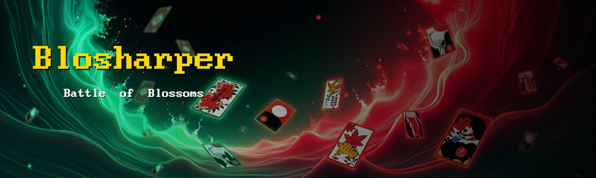
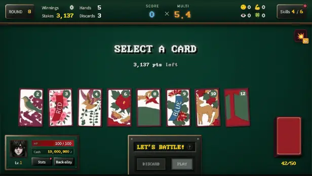

<!--
  Images are referenced by relative path. If the org profile page does not resolve them,
  use the raw form instead (rig-c's profile does):
    https://raw.githubusercontent.com/Blosharper/.github/main/profile/banner.jpg
    https://raw.githubusercontent.com/Blosharper/.github/main/profile/play.webp?v=<sha>
-->

  

  <a href="#user-content-where-to-play"><b>▶ Play the game</b></a> Steam · STOVE · free demo
  &nbsp;&nbsp;|&nbsp;&nbsp;
  <a href="#user-content-under-the-hood"><b>⚙ Explore the tools</b></a> four open-source build and platform tools

  

<em>One hand, as shipped. Pick up to five of eight, Play or Discard, watch Score × Multi climb — then decide whether to call Go.</em>

**Blosharper is a card-shark noir roguelike deckbuilder: forge Korean Hwatu card combos to smash each round's target score.**
Don't rely on luck — use illicit "cheat" skills to rig the deck and survive a deadly underground gambling den. Pay off your debt, defeat the bosses, become the ultimate sharp!

『블로샤퍼(Blosharper)』는 화투 패로 족보를 짜 라운드 목표 점수를 돌파하는 타짜 느와르 로그라이크 덱빌딩 게임입니다. 순수한 운에 기대지 마세요. 무자비한 지하 도박판에서 은밀한 '꼼수' 스킬을 조합해 빚을 갚고, 사천왕 보스를 무너뜨려 전설의 타짜로 살아남으세요.

『Blosharper（ブロシャーパー）』は韓国の花札で役を組み、各ラウンドの目標スコアを突破するイカサマ師ノワール・ローグライクデッキ構築ゲームです。純粋な運に頼ってはいけません。無慈悲な地下賭博場で隠密な「イカサマ」スキルを組み合わせて借金を返し、残忍なボスたちを打ち破って伝説のイカサマ師として生き残りましょう！

  <b>PC · Windows &amp; macOS</b> &nbsp;·&nbsp; <b>7 languages</b> &nbsp;·&nbsp; <b>15+</b> (Korea, GRAC) &nbsp;·&nbsp; Early Access 2026‑06‑24 → <b>1.0 on 2026‑10‑08</b>

### Where to play

| | Full game | Free demo |
| :-: | --- | --- |
| **Steam** | [store.steampowered.com/app/4718270](https://store.steampowered.com/app/4718270/) | [app/4770920](https://store.steampowered.com/app/4770920/) |
| **STOVE** | [store.onstove.com/ko/games/105719](https://store.onstove.com/ko/games/105719) | [games/105740](https://store.onstove.com/ko/games/105740) |
<!-- mobile: add these rows only when BOTH stores are public (same-day open).
| **App Store** | (iOS / macOS link) | — |
| **Google Play** | (Android link) | — |
-->

  <a href="https://www.youtube.com/watch?v=MOZFmQFNdLE"><b>▶ Trailer (한국어)</b></a> &nbsp;·&nbsp;
  <a href="https://www.youtube.com/watch?v=fRmHvBgpXbk"><b>▶ Trailer (English)</b></a> &nbsp;·&nbsp;
  <a href="https://www.youtube.com/watch?v=EX65PFu_q10"><b>▶ Trailer (日本語)</b></a>

  <a href="https://blosharper.com/">blosharper.com</a> &nbsp;·&nbsp;
  <a href="https://discord.gg/Nf7Ctt9f3">Discord</a> &nbsp;·&nbsp;
  <a href="https://x.com/blosharper">X</a> &nbsp;·&nbsp;
  <a href="https://www.youtube.com/@blosharper">YouTube</a> &nbsp;·&nbsp;
  <a href="https://blosharper.com/support.html">Support</a>

### Player guides

The in-game help is also published on the official site. The guides are written in Korean; the site offers a machine translation for the other languages.

| Guide | Open |
| --- | --- |
| Game guide — cards, hands, rounds, the shop, the four decks | [blosharper.com/#/guide/game-guide](https://blosharper.com/#/guide/game-guide) · [GitHub](https://github.com/Blosharper/blosharper.com/blob/main/teaser/docs/manuals/GAME_GUIDE.md) |
| How to play — never seen Hwatu? start here | [blosharper.com/#/guide/how-to-play](https://blosharper.com/#/guide/how-to-play) · [GitHub](https://github.com/Blosharper/blosharper.com/blob/main/teaser/docs/manuals/HOW_TO_PLAY.md) |
| Skills guide — the 100 trick skills and what they do | [GitHub](https://github.com/Blosharper/blosharper.com/blob/main/teaser/docs/manuals/SKILLS_GUIDE.md) |
| Boss battles and penalties | [GitHub](https://github.com/Blosharper/blosharper.com/blob/main/teaser/docs/manuals/BOSS_BATTLE.md) |
| Strategy guide | [GitHub](https://github.com/Blosharper/blosharper.com/blob/main/teaser/docs/manuals/STRATEGY_GUIDE.md) |
| Keyboard shortcuts | [GitHub](https://github.com/Blosharper/blosharper.com/blob/main/teaser/docs/manuals/KEYBOARD_SHORTCUTS.md) |
| UI / UX guide | [GitHub](https://github.com/Blosharper/blosharper.com/blob/main/teaser/docs/manuals/UI_UX_GUIDE.md) |
| Skill prices · unlock conditions | [prices](https://github.com/Blosharper/blosharper.com/blob/main/teaser/docs/manuals/SKILLS_PRICING.md) · [unlocks](https://github.com/Blosharper/blosharper.com/blob/main/teaser/docs/manuals/SKILLS_UNLOCK.md) |

### Under the hood

Blosharper is a **DOM game**: the table, the cards, the score board and the menus are HTML elements styled with CSS, written in TypeScript, built with Vite and shipped as an Electron app on Windows and macOS. The browser's own layout and compositor do the drawing, and the same bundle is the game on every platform it ships to.

The game repository is private. The pieces of its build and platform tooling that are useful on their own live here as open source:

| | Repository | Install | What it does |
| :-: | --- | --- | --- |
| 1 | [**byteguard**](https://github.com/Blosharper/byteguard) | `npm i -D vite-plugin-byteguard` | Encodes JS bundles into a binary format for casual source-code protection. Not encryption, not DRM — it raises the cost of reading a shipped bundle from *open the file* to *reverse-engineer the loader*. Bundler-agnostic core `byteguard` + a Vite adapter |
| 2 | [**headerless**](https://github.com/Blosharper/headerless) | `npm i -D vite-plugin-headerless` | Strips the format-defining header fields from binary assets (PNG, JPEG, WebP) at build time and puts them back in memory at runtime. The removed bytes are a per-file key, so publishing the algorithm does not weaken it. Core `headerless` + a Vite adapter |
| 3 | [**stovesdk.js**](https://github.com/Blosharper/stovesdk.js) | `npm i stovesdk.js` | Unofficial Node.js / Electron bindings for the STOVE PC SDK (N-API): initialize, callback pump, ownership, achievements and stats, login identity. Windows x64, with the prebuild in the package; the SDK itself is yours to download |
| 4 | [**l10n-c**](https://github.com/Blosharper/l10n-c) | `npm i -D l10n-c vite-plugin-l10n-c` | Locale file editing for people and coding agents: search, update, rename, delete and replace keys across every locale in one command; checks missing, nested, duplicate and unused keys. Core CLI `l10n-c` + a Vite dev-server translation manager with inline editing and CSV export |

All four are MIT licensed and are dogfooded in the shipped game.

### Credits

<em>a Joon x Jin production</em> 
Jinnie · Jeje · Chloe · Ria · Ari · Joon · Loa · Luna · Sohee · Sia · May · Nova 
as named in the game's staff roll — one developer, and the family the credits name

